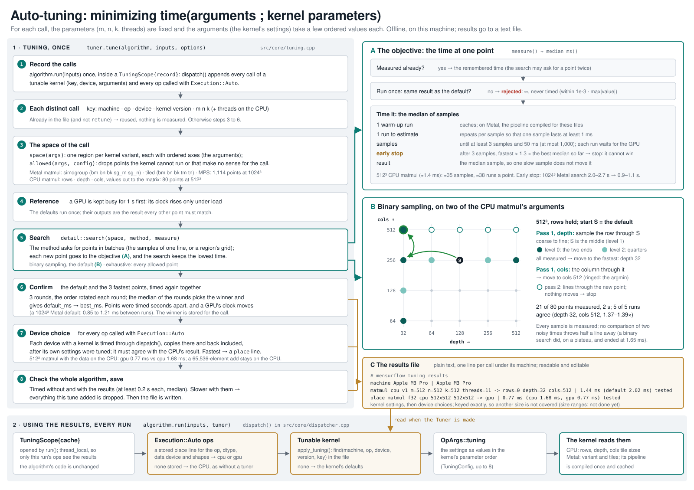

# Auto-tuning

Two things are tuned **for a particular algorithm**: the settings of kernels that have some (tile
sizes, which kernel variant to use), and the **device** each op runs on when it is called with
`Execution::Auto` (the default of every op). The user writes the algorithm as a function, the tuner measures the calls that function
makes on this machine, and the best settings are kept in a text file so later runs reuse them.



Where it sits in the library: [architecture.svg](architecture.svg).

```cpp
#include "mensurflow/mensurflow.hpp"
namespace mf = mensurflow;

mf::Algorithm network([](const std::vector<mf::Tensor>& in) {
    mf::Tensor h = mf::matmul(in[0], in[1], mf::Execution::GPU);
    return std::vector<mf::Tensor>{mf::matmul(h, in[2], mf::Execution::GPU)};
});

mf::Tuner tuner("mensurflow_tuning.txt");      // reads earlier results, if any
mf::TuneReport report = tuner.tune(network, {x, w1, w2});
auto out = network.run({x, w1, w2}, tuner);    // runs with the stored settings
```

`examples/tune_mlp.cpp` is a complete program (`build/tune_mlp [batch] [cpu]`). The observability
dashboard has an **Autotune** section on every op page that tunes the op for a device and size and
shows the function being minimized, the fixed kernel parameters, the arguments at the minimum against
the defaults, the search point by point, and slices of the time through the minimum
([observability/README.md](../observability/README.md)).

## Modes

| mode | status | what it tunes |
|---|---|---|
| offline, tested: `Tuner::tune(algorithm, inputs)` | **done** | every tunable call the algorithm makes on exactly these inputs, and the device of every `Execution::Auto` call; then the whole algorithm is timed with the default and the tuned results, and the new results are dropped if tuning made it slower |
| offline, untested: shape ranges | planned | the same calls at a representative size of every power-of-two size class in a range, stored as size-class results that cover the shapes between |
| online | planned | during real runs, calls without a stored result try the candidates one call at a time and store the fastest |

## Tuning as minimizing a function

For one call of a tunable kernel, tuning is the minimization of a function of discrete arguments:

```
time(arguments ; kernel parameters) -> min
```

- The **kernel parameters** are fixed by the call: for matmul m, n, k (plus the thread count on the
  CPU). They are the key the result is stored under.
- The **arguments** are the kernel's settings (tile sizes and the like). Each takes a few discrete
  values in order along its axis.
- The **objective** is the median time per call. A point whose result differs from the default's
  is rejected (infinite time).

A kernel variant (the Metal matmul's tiled, simdgroup and MPS kernels) is a category, not a point on an
axis, so each variant is its own **region** of the space, with its own arguments; the parameters it
does not use stay fixed. A kernel declares its space with `space(args)` (the regions and their axes)
and `allowed(args, config)` (which points are valid and worth running for this call).

| kernel | regions | arguments | allowed points (512^3) |
|---|---|---|---|
| matmul, Metal | simdgroup / tiled / MPS | bm, bn, bk, sg_m, sg_n / bm, bn, bk, tm, tn / none | 222 / 891 / 1 |
| matmul, CPU without AVX2 | tiles | rows, depth, cols | 80 |

### Search methods (`TuneOptions::search`)

- **Binary sampling** (the default, name `binary`). Start at the region's start point (the default
  settings, or the nearest allowed point). Take one argument at a time, holding the others, and
  sample the values the others allow from coarse to fine:
  - level 0: the two ends of the line;
  - level 1: the middle;
  - level 2: the quarter points, and so on down to `levels` (2 by default, which samples every value
    of a line of up to 5 values and 5 of 6).

  Every sample is measured and the point moves to the best one. Passes over all the axes repeat until
  one changes nothing (at most `max_sweeps`). Each point is measured once and then remembered.

  It replaced a coordinate binary search. That search compared two neighbouring times and threw half
  the line away, so noise on a plateau could send it the wrong way. The CPU matmul's depth axis shows
  this (32: 1.42 ms, 64: 1.53, 128: 1.68, 256: 1.66, 512: 1.67). The search's first comparison, 128
  against 256, came out either way, and runs ended at 1.42 or at 1.65 ms. Sampling rules nothing out
  by a comparison. It can still miss a minimum that falls between samples, or one that needs two
  arguments changed at once.
- **Exhaustive**: every allowed point of every region. This gives the true minimum of what can be
  measured, but is slow (over 1,100 points for the Metal matmul).

On the M3 Pro, binary sampling measured 34 of 1,114 points of a 1024^3 Metal matmul in about 4 s
(MPS, 1.09 to 1.16x), and 21 of 80 of a 512^3 CPU matmul in 2 s (depth 32, cols 512, 1.37 to
1.39x). Five repeated runs agreed. The search itself is `detail::search` in
`src/core/tuning.cpp`: it takes the objective as a function, so further methods can be added next to
the two above. `tests/core/tuning_test.cpp` checks both on a synthetic function with a known minimum.

## What `tune()` does

1. Runs the algorithm once on the given inputs and records every call of a tunable kernel (its
   arguments, device and shapes). The run is real, so ops that read values partway through and
   branches that depend on data behave as they will later.
2. Keeps each GPU busy for one second, because the GPU raises its clock only under sustained load.
3. For each distinct call, and only if no result is stored for it yet (unless `retune`):
   - runs the call with the kernel's defaults and keeps that result as the reference;
   - searches the kernel's space with the chosen method. Each point is run once and rejected if it
     disagrees with the reference (more than 1e-3 of the largest magnitude), then timed: the median of
     samples of at least 1 ms each, taking at least `min_time_s` and at least `min_samples` samples.
     **Early stop** (`give_up`, 1.3): after `min_samples` samples, a point whose fastest sample is
     already 1.3x the best median so far stops being timed, since it cannot win. On a 1024^3 Metal
     matmul, where most tile sizes are far slower than the best, this cut the search from 2.0 to 2.7 s
     down to 0.9 to 1.1 s (25 to 36 points stopped), with the same result (MPS). On a 512^3 CPU matmul,
     where most points are within 1.3x of each other, it stops few points and saves little;
   - times the default and the `confirm` (3) fastest points again, taking turns in three rounds, and
     keeps the fastest of those, which can be the default. Points are measured seconds apart, and the
     GPU clock or the load can change in between. Without this, a 1024^3 Metal matmul's default was
     timed at 0.85 ms in some runs and 1.21 ms in others;
   - stores the result.
4. For every op called with `Execution::Auto`, chooses the device: each device that has a kernel for
   the op is timed through the normal dispatch, **including copying the inputs there and the result
   back** (the data stays where it lives). A device's tunable kernel settings are tuned first, so
   every device is compared at its best, and its result must agree with the CPU's. The fastest is
   stored. Without a stored choice, `Execution::Auto` runs on the CPU, as before.
5. Times the whole algorithm with and without the results, and saves the file. If the tuned run was
   slower, everything this tune added is dropped.

Each op chooses its device on its own, and its result always comes back to where the data lives.
A chain of ops therefore pays the copies once per op; keeping the data on the GPU across several ops
would need a plan for the whole algorithm (not done yet). Device choice for one op is keyed on the op,
the dtype, the device the data is on, and the input shapes.

Calls are keyed on the kernel's own key (for matmul: m, n, k) plus the thread count on the CPU, and
on the machine. A result is applied only to exactly that call, on that machine, and for that kernel
version.

## The results file

Plain text, one result per line, grouped under the machine it was measured on. It can be edited or
trimmed by hand; lines starting with `#` are comments.

```
machine Apple M3 Pro | Apple M3 Pro
matmul cpu v1 m=128 n=4096 k=1024 threads=11 -> rows=16 depth=64 cols=1024 | 8.4586 ms (default 10.4356 ms) tested
matmul metal v1 m=256 n=4096 k=1024 -> kernel=2 bm=0 bn=0 bk=0 tm=0 tn=0 sg_m=0 sg_n=0 | 0.7838 ms (default 0.8820 ms) tested
```

`<op> <device> v<version> <key> -> <settings> | <best> ms (default <ms> ms) <mode>`. Settings a
kernel does not use are 0. A malformed line is reported with its line number when the file is read.

Device choices have their own lines (times include the copies):

```
place matmul f32 cpu 512x512 512x512 -> gpu | 0.7584 ms (cpu 1.5547 ms, gpu 0.7584 ms) tested
place add f32 cpu 65536 65536 -> cpu | 0.0307 ms (cpu 0.0307 ms, gpu 0.2800 ms) tested
```

## Tunable kernels so far

| kernel | arguments |
|---|---|
| matmul, Metal | per variant (`kernel` 0 tiled, 1 simdgroup, 2 MPS): tile `bm` x `bn` x `bk` from 8 to 128; `tm` x `tn` per thread 1 to 8 (tiled); `sg_m` x `sg_n` simdgroups 1 to 4 (simdgroup). Allowed: valid configurations, tiles at most about twice the matrix, simdgroup with 1 to 8 accumulator blocks and 64 to 512 threads, tiled with at least 32 threads |
| matmul, CPU without AVX2 | `rows` 4 / 16 / 64 / whole band, `depth` 32 to 512, `cols` 64 to 2048, cut off at the matrix's own size |

The AVX2 packed CPU kernel is not tunable yet (its `PackedGemmBlocking` would be next).

## Making a kernel tunable

In the backend's `register_kernels`, next to `register_kernel`, register a `TunableKernel`
(`src/core/dispatcher.hpp`):

- `name` and `version`: the name in the file; raise the version whenever the kernel changes, so
  results measured on the old kernel are ignored;
- `key_names` and `key(args)`: what a call is identified by;
- `params` (at most 8) and `defaults()`: the settings and what the kernel does without tuning;
- `space(args)`: the regions (one per kernel variant), each with a start point and its axes (a
  parameter and its values, in order along the axis); empty means nothing to tune for this call;
- `allowed(args, config)`: whether a point is valid and worth running for this call;
- in the kernel itself, read `args.tuning` (`size == 0` means use the defaults; otherwise the values
  are in `params` order) and reject invalid values with `std::invalid_argument`, since the file can
  be edited by hand.

dispatch() only looks for tunable kernels while a tuner is active (`Algorithm::run(inputs, tuner)`
or `Tuner::tune`), so calls outside an algorithm cost nothing extra.
